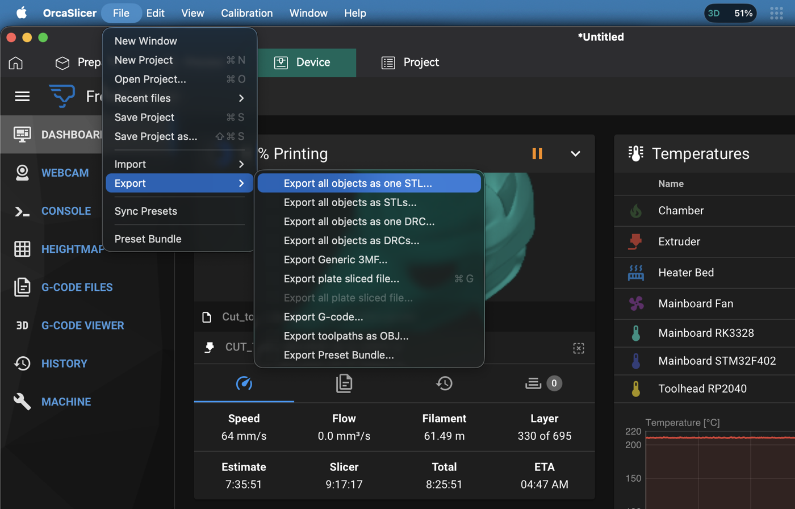
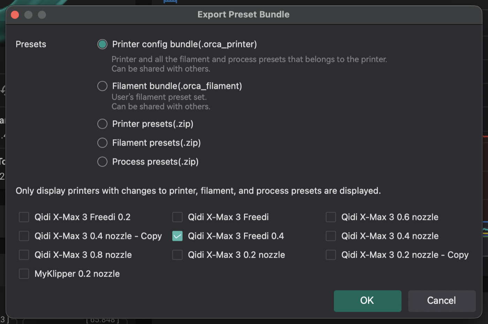
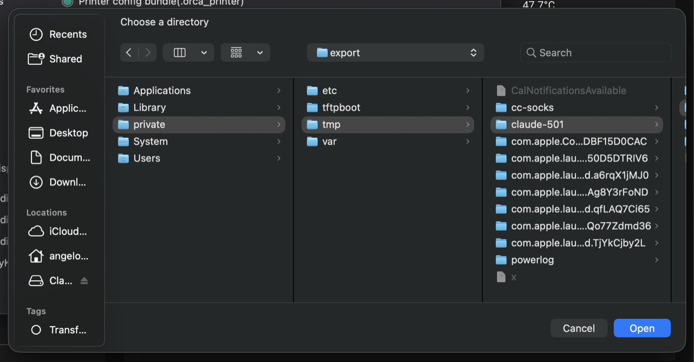
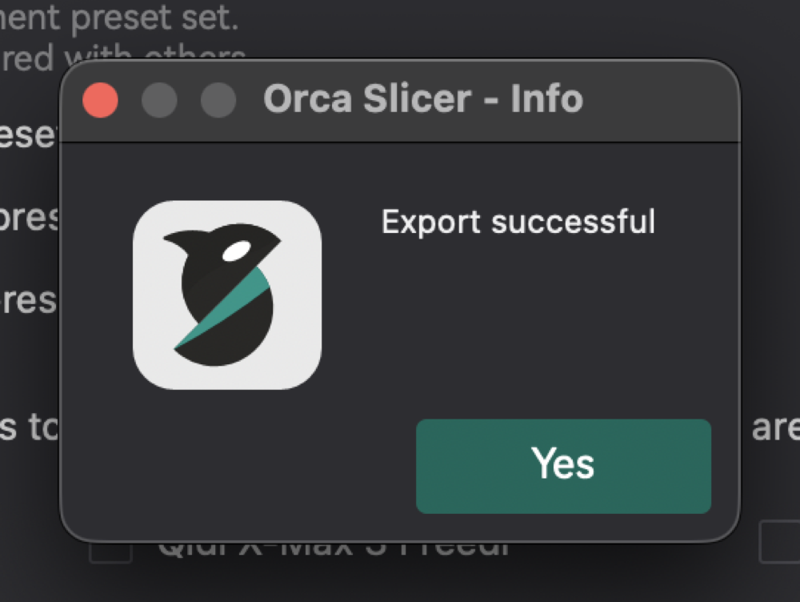
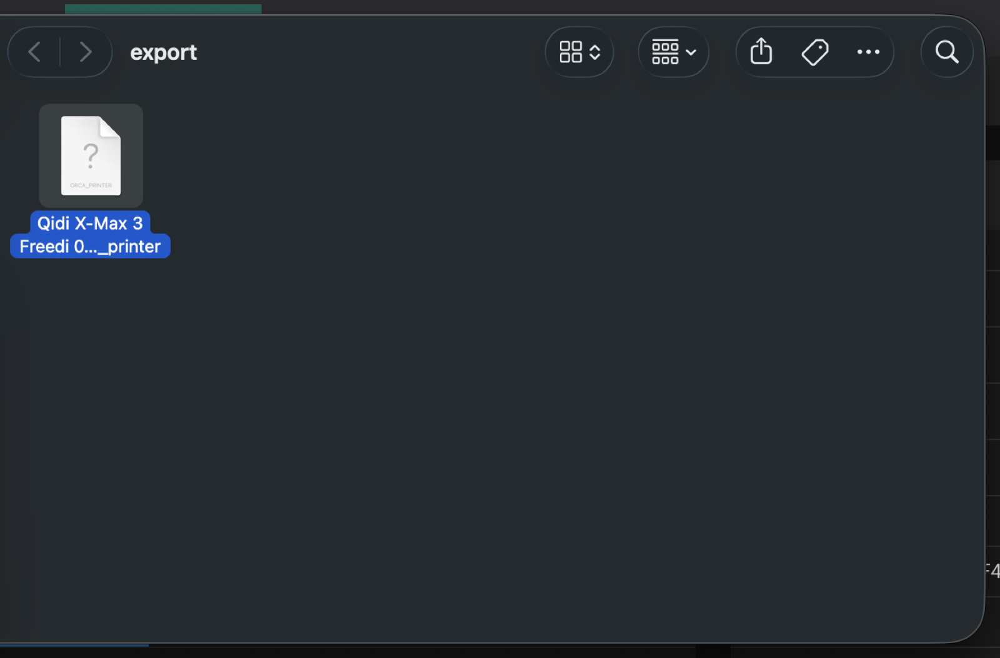
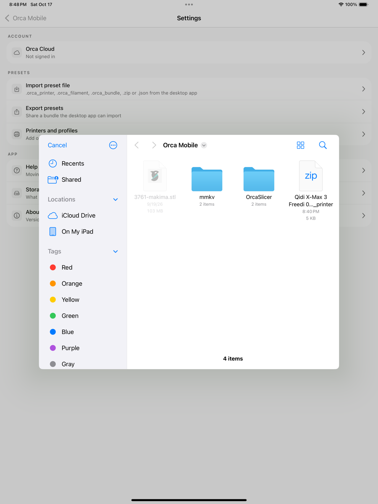
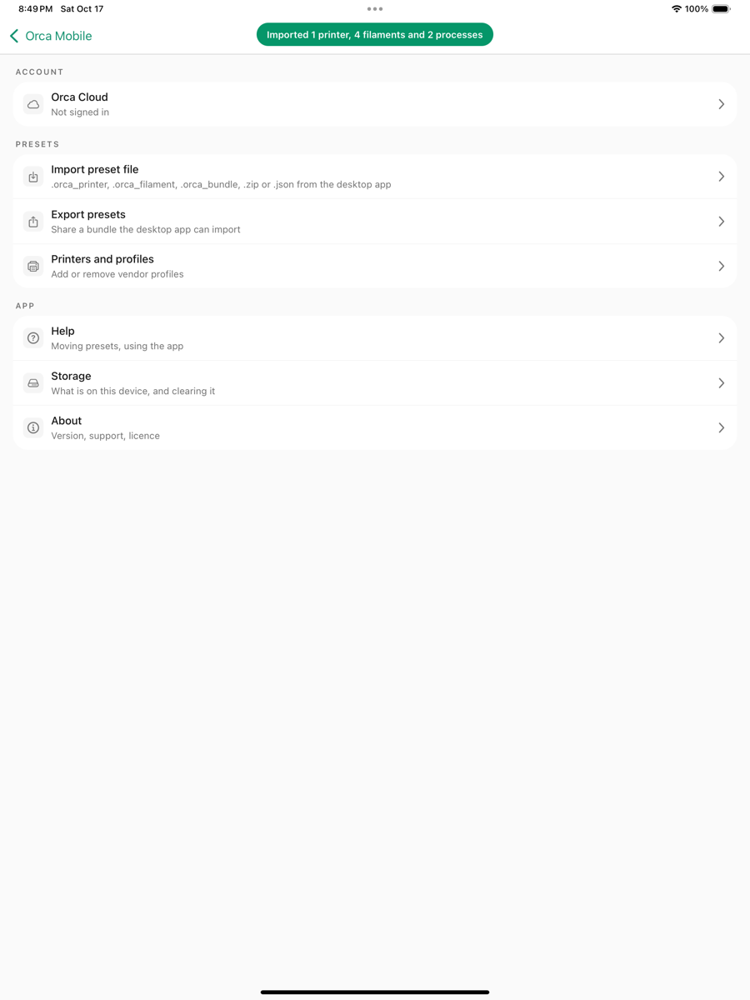
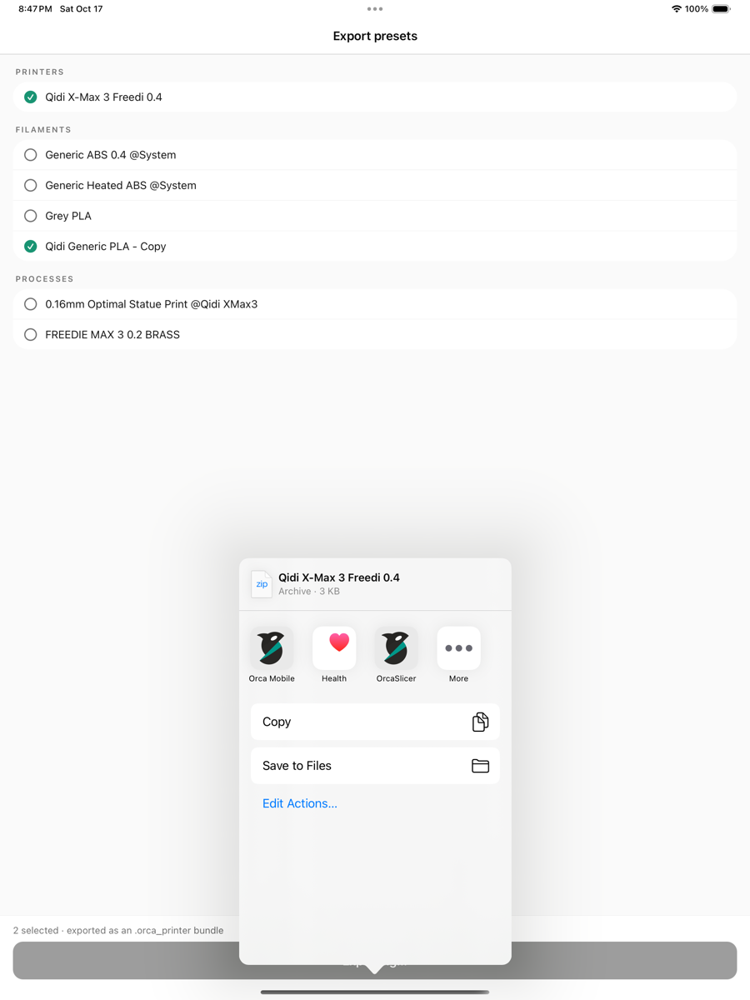
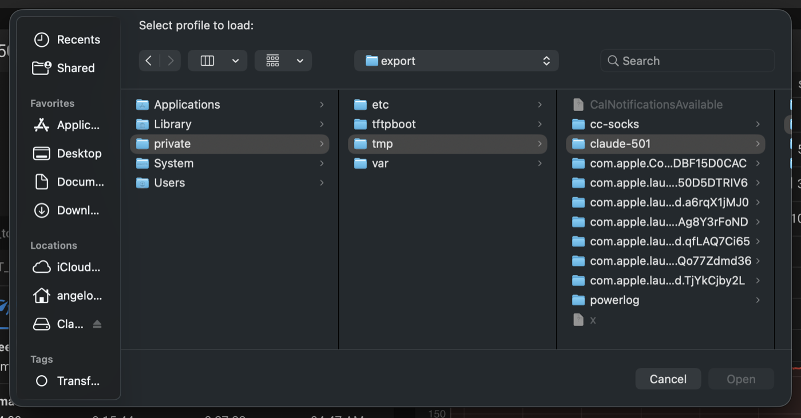
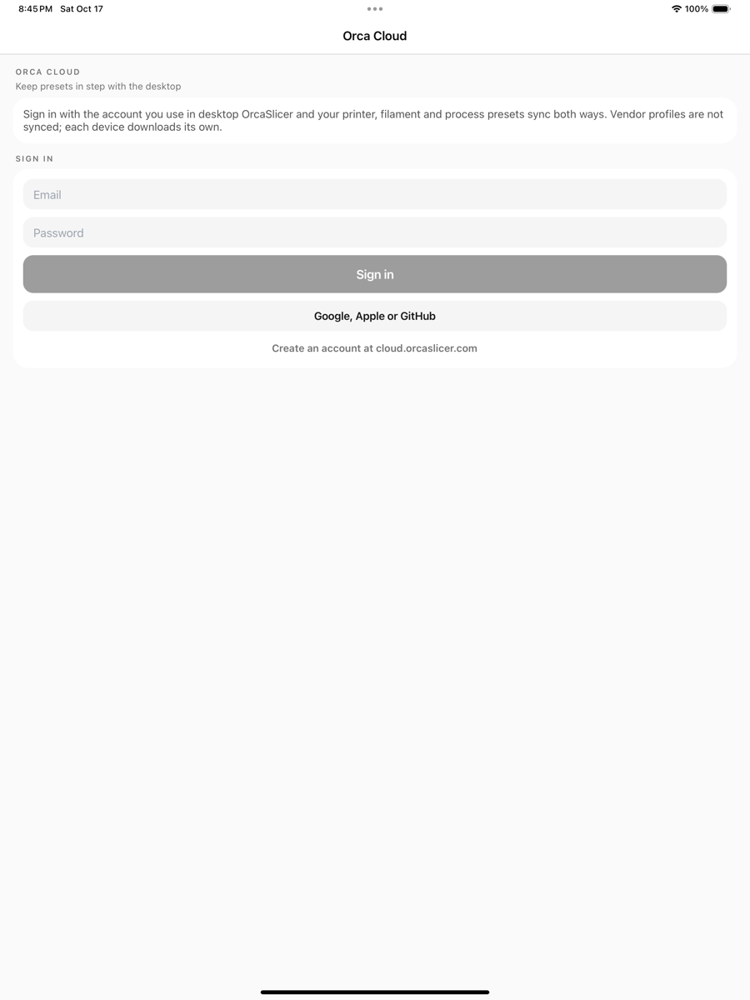

# Move presets between desktop and phone

Export your printer, filament and process presets from OrcaSlicer on the computer, import them here, and send changes back.

> This page is generated from the guide inside the Orca iOS app (`mobile/apps/orca/lib/help/content.ts`). Edit that file and run `pnpm help-docs` in `mobile/`.

## Export from the desktop app

Desktop OrcaSlicer bundles a printer together with every filament and process preset you made for it into one .orca_printer file. That file is what you bring to the phone.

### 1. Open the export dialog

On macOS choose File ▸ Export ▸ Export Preset Bundle… from the menu bar. On Windows and Linux click the File button in the title bar, then Export ▸ Export Preset Bundle….

### 2. Pick what to export

Leave "Printer config bundle (.orca_printer)" selected and tick the printer you want on the phone. The bundle includes every user filament and process that is compatible with that printer. Built-in presets are not exported; save a built-in preset under your own name first if you want it included.

### 3. Choose where to save

Press OK and pick a folder. Desktop writes one file per printer, named after the printer.

### 4. Wait for the confirmation

A small "Export successful" dialog closes the export. The file is a plain zip of preset JSON files with an .orca_printer extension, so it travels like any other document.

### 5. Get the file to your phone

AirDrop it, save it to iCloud Drive, or attach it to a message to yourself. Printer bundles are small, usually well under a megabyte, and your printer’s network address and API key are stripped before export.

## Import on the phone

### 6. Open the file

Tap the .orca_printer in Files, in the AirDrop prompt or in a message, then choose Orca. You can also tap Import on the Presets card and pick the file yourself. Single preset .json files, .orca_filament bundles and the .zip exports work the same way.

### 7. Install the printer’s profiles if asked

Your presets are stored as changes on top of the vendor’s profiles, so those profiles must be on the phone. If they are missing, Orca offers to download the right printer from the catalogue and then finishes the import.

### 8. Check the result

A toast tells you what came in. The imported printer is selected for you, and its filaments and processes appear under My presets in each picker. Imported presets are ordinary user presets: edit, rename, delete and sync them like any other.

## Send changes back to the desktop

### 9. Export from the phone

Open the preset (tap its row on the Presets card), then Export. Choose Printer bundle to get an .orca_printer with the printer plus its compatible user filaments and processes, or JSON file for just this preset. Share it to your computer.

### 10. Import on the desktop

In desktop OrcaSlicer choose File ▸ Import ▸ Import Configs…, select the file and confirm. Presets with the same name as one you already have ask before they are replaced.

## Or let Orca Cloud do it

If you sign in to the same Orca Cloud account on both, user presets sync by themselves: save on one side, see it on the other. Files are still the way to go for sharing with other people or when you do not want an account.

### 11. Sign in on both

Desktop: Preferences ▸ Sync user presets, then sign in from the account button. Phone: Settings ▸ Account ▸ Sign in to Orca Cloud. Both must use the same account.

### 12. When things sync

The phone pulls and pushes when you open the app, after you save or delete a preset, and when you tap Sync now. The desktop pushes about once a minute and pulls when it starts, so a change made on the phone shows up there after a restart or a manual sync.
