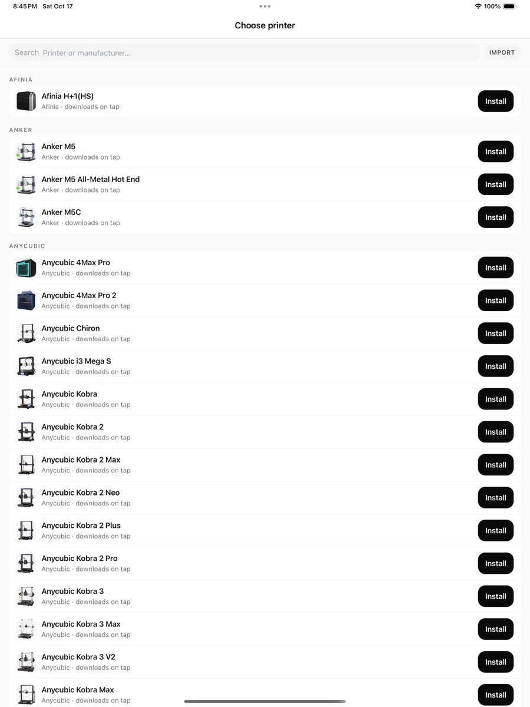
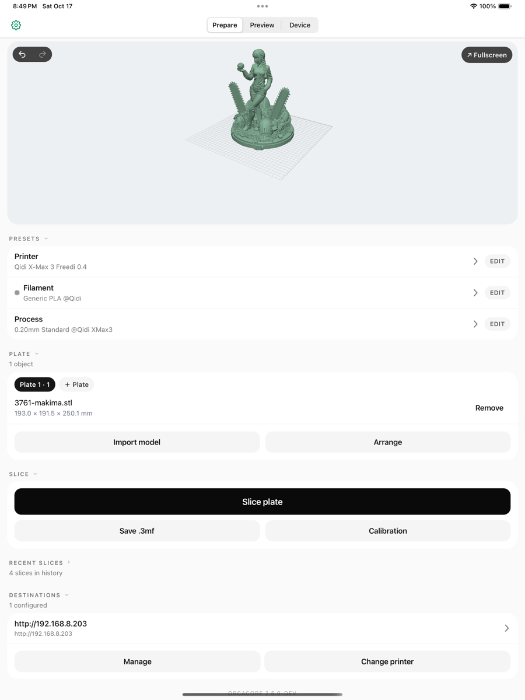
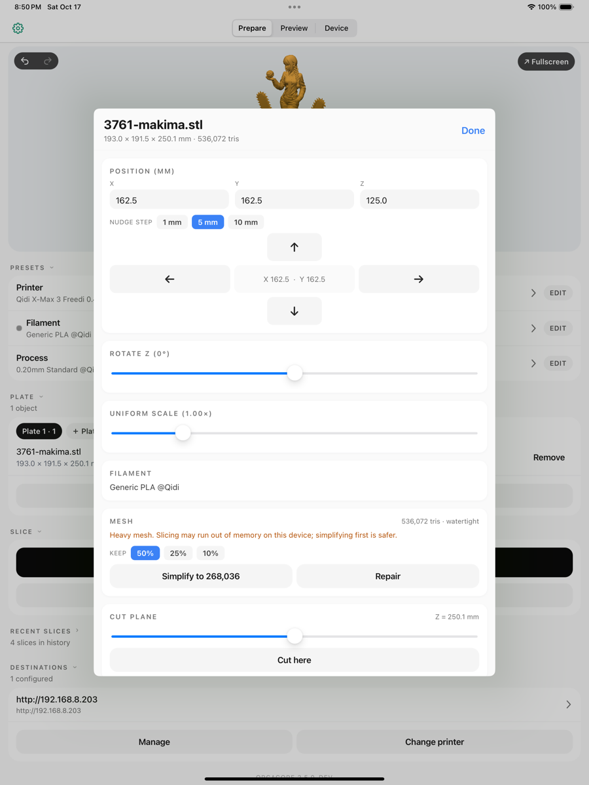
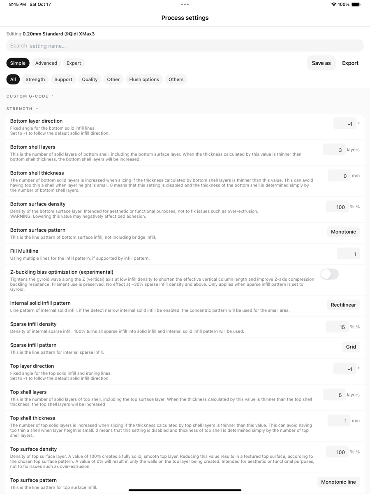
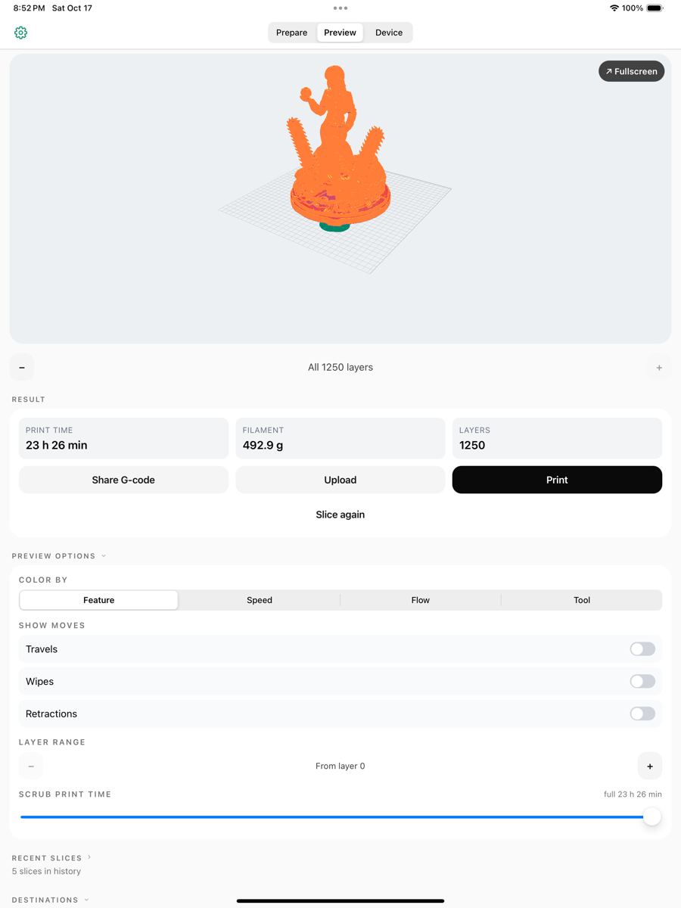
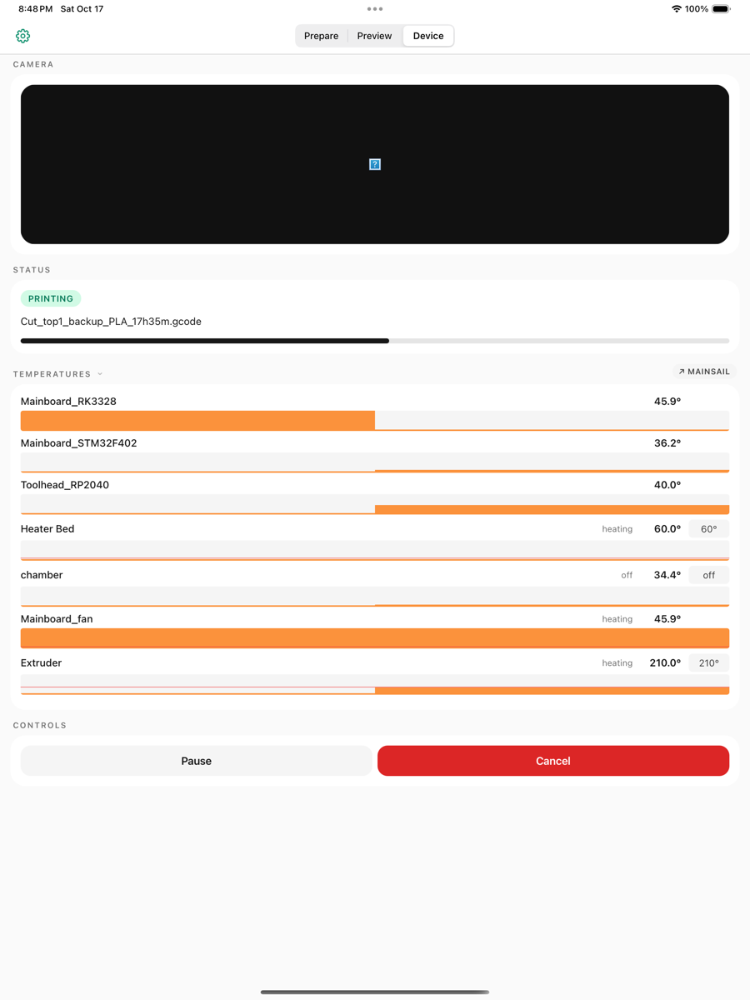
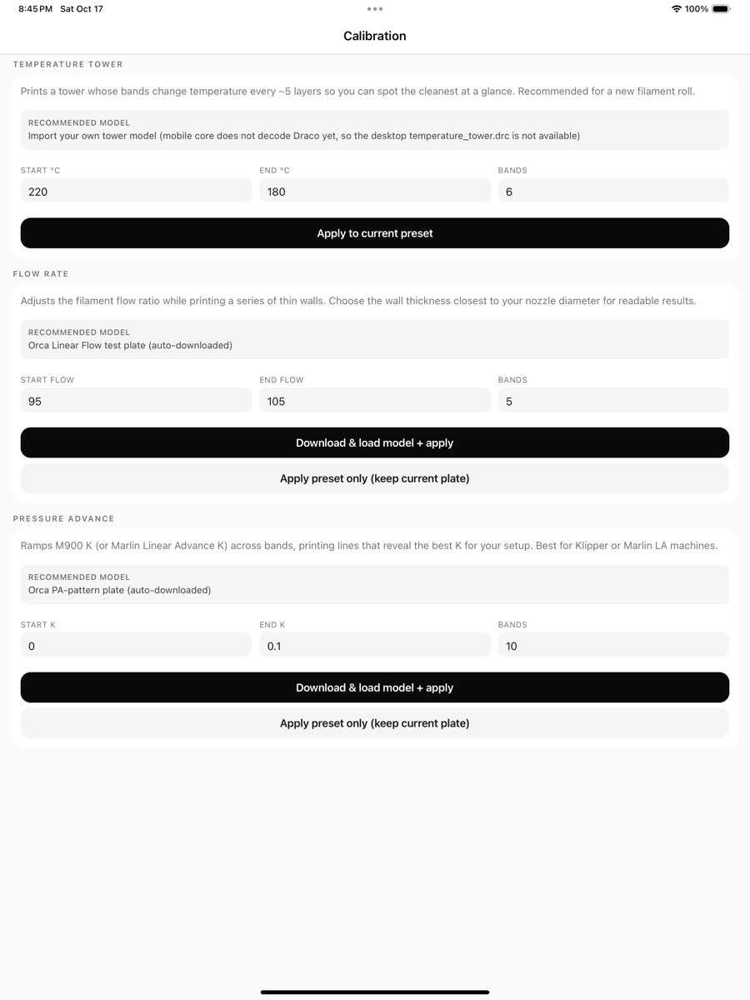
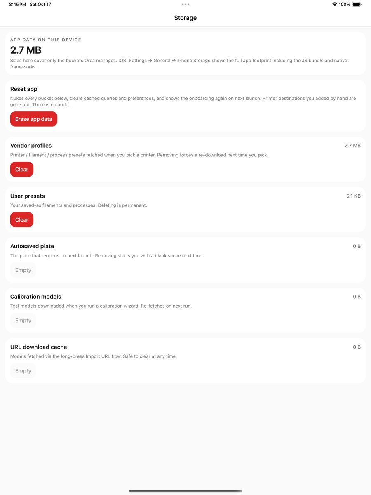

# Using Orca on iPhone and iPad

From picking a printer to sending G-code, in the order you will do it.

> This page is generated from the guide inside the Orca iOS app (`mobile/apps/orca/lib/help/content.ts`). Edit that file and run `pnpm help-docs` in `mobile/`.

## Set up

### 1. Choose a printer

Tap Change printer on the Presets card, search for your machine and tap Install. Only that printer’s profiles are downloaded, together with the shared filament library. Add more printers at any time from the same screen.

### 2. Add a destination

Open the Device pane and tap Add printer. Orca talks to Moonraker (Klipper) and OctoPrint hosts; scan the local network or type the address. Test the connection before saving.

## Prepare

### 3. Bring in a model

Tap Import model on the Plate card for a .3mf, STL, OBJ or STEP from Files or iCloud, or open a file from any app and choose Orca. A .3mf project replaces the whole plate layout; other files are added to the current plate.

### 4. Arrange and edit

Drag to orbit, two fingers to pan, pinch to zoom, double-tap to fit. Tap an object to select it; the toolbar switches between Move, Rotate and Scale, and the object sheet has lay flat, auto-orient, mirror, cut and duplicate. Arrange packs everything on the plate; the expand button opens a landscape, full-screen editor.

### 5. Pick presets and tweak settings

The Presets card shows the printer, filament and process in use. Tap a row to switch, or tap the gear to edit values. The editor is the desktop’s parameter list with Simple, Advanced and Expert levels and a search box; changed values are marked, and Save as keeps them as your own preset.

## Slice and print

### 6. Slice

Tap Slice plate. Progress shows on the card; large models take a while on a phone. The Preview pane then shows the toolpaths with a layer slider, colouring by feature, speed or filament, plus time, filament use and cost.

### 7. Send or save the G-code

Send to a destination starts the print on your Moonraker or OctoPrint host. Share saves the G-code to Files or another app. The Device pane follows the job with temperatures, progress and the camera, and a Live Activity keeps it on the Lock Screen.

### 8. Calibrate

Calibration on the Presets card generates the desktop’s test prints: flow, pressure advance, temperature and retraction towers, with the matching settings applied to a copy of your process preset.

## Keep things tidy

### 9. Projects and history

Save project writes a .3mf with the plate, models and presets, re-openable here or on the desktop. The home screen remembers recent projects and prints, and the plate is autosaved so a force-quit does not lose your layout.

### 10. Storage

Settings ▸ Storage shows what the downloaded profiles, projects and G-code take up, lets you clear each category, and can reset the first-run guide.

